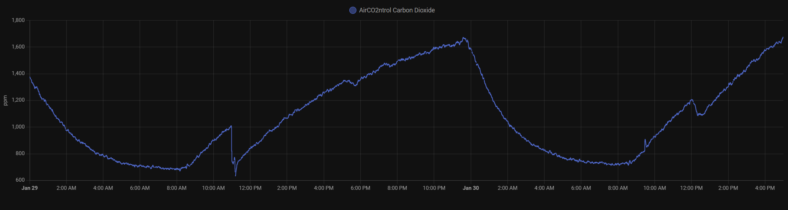

# Aircontrol CO2 Monitor Mini TFA

A custom [home-assistant](https://www.home-assistant.io/) component for a family of compatible CO2 monitors distributed under various names
 - [TFA Dostmann CO2 Monitor AIRCO2NTROL MINI](https://www.tfa-dostmann.de/en/produkt/co2-monitor-airco2ntrol-mini/).
 - [ZyAura ZGm053U](https://www.zyaura.com/product-detail/zgm053u/)
 - [TFA Dostmann CO2 Monitor AIRCO2NTROL COACH](https://www.tfa-dostmann.de/en/product/co2-monitor-airco2ntrol-coach-31-5009/)
 - [ZyAura ZGm27](https://www.zyaura.com/product-detail/zgm27/)

Idea based on "[Reverse-Engineering a low-cost USB CO₂ monitor](https://hackaday.io/project/5301-reverse-engineering-a-low-cost-usb-co-monitor)".
Thx [Henryk Plötz](https://hackaday.io/henryk). Code for this HA integration originally taken from [jansauer](https://github.com/jansauer/home-assistant_config/tree/master/config/custom_components/airco2ntrol). 
Some older devices have a static encryption (as [Henryk Plötz](https://hackaday.io/henryk) found out). 
This integration is both, with the newer and older devices compatible.

## Setup
 
> **Upgrading from a very old version?** Remove `airco2ntrol` from your `configuration.yaml` before proceeding.

### Option A: HACS
 
1. Open HACS, search for **airco2ntrol** and install it
2. Restart Home Assistant
3. Go to **Settings -> Integrations -> Add Integration**, search for `co2` and select **airco2ntrol**
4. Optionally enter a custom device path (e.g. `/dev/airco2ntrol`), or leave empty for auto-discovery
5. Once your CO2 sensor is attached, the integration will create 3 entities automatically

 
### Option B: Manual Installation
 
1. Copy the `custom_components/airco2ntrol` folder to `config/custom_components/airco2ntrol/`
   *(Use the Samba or SSH/SFTP add-on to access your config folder)*
2. Restart Home Assistant
3. Go to **Settings -> Integrations -> Add Integration**, search for `co2` and select **airco2ntrol**
4. Optionally enter a custom device path (e.g. `/dev/airco2ntrol`), or leave empty for auto-discovery
5. Once your CO2 sensor is attached, the integration will create 3 entities automatically

## Docker Setup

When running Home Assistant as [Home Assistant Container](https://www.home-assistant.io/installation/#about-installation-types), the container needs access to the USB HID device. Instead of using `privileged: true`, you can pass through the device directly.

### Option 1: Direct device mapping

```yaml
services:
  homeassistant:
    # ...
    devices:
      - /dev/hidraw0:/dev/hidraw0
    volumes:
      - /sys:/sys:ro
```

> **Note:** The `hidraw` device number can change after a replug. See Option 2 for a stable setup.

### Option 2: udev rule with stable symlink (recommended)

1. Find the Vendor/Product ID of your device on the host:
   ```bash
   cat /sys/class/hidraw/hidraw*/device/uevent | grep HID_ID
   ```
   This gives e.g. `HID_ID=0003:000004D9:0000A052` — the last two parts are VID:PID.

2. Create a udev rule on the host:
   ```bash
   sudo nano /etc/udev/rules.d/99-airco2ntrol.rules
   ```
   ```
   SUBSYSTEM=="hidraw", ATTRS{idVendor}=="04d9", ATTRS{idProduct}=="a052", SYMLINK+="airco2ntrol", MODE="0666"
   ```
   ```bash
   sudo udevadm control --reload-rules
   sudo udevadm trigger
   ```

3. Update your `docker-compose.yaml`:
   ```yaml
   services:
     homeassistant:
       # ...
       devices:
         - /dev/airco2ntrol:/dev/airco2ntrol
       device_cgroup_rules:
         - 'c 240:* rmw'
   ```

4. In the integration config flow, enter `/dev/airco2ntrol` as the device path.

This way, no `privileged: true` and no `/sys` mount are needed.

## Functionality
This is how your sensors measurement might look:



This integration should provide:
 - CO2 values
 - Temperature
 - OPTIONAL: Humidity

Some devices appear to have a humidity readings. If they do so, then the humidity entity will be usable.

## Notes
The pdf in this repository describes the usb protocol used by airco2ntrol device

